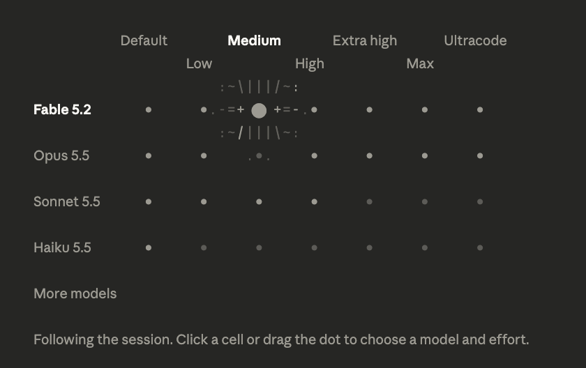

# model-picker

Pick Claude Code's model and effort level on a grid, with one dot.



[Watch the 18-second launch video](assets/launch.mp4)

## Install

In Claude Code:

```
/plugin install model-picker --marketplace nithinaru/model-picker
```

Answer `y` to add the marketplace, then choose a scope.

## Use

- Click **Pick model** above the prompt, or type `/model-picker`.
- Drag the dot anywhere on the grid and let go: it settles on the nearest cell. A click or the arrow keys work too.
- **More models** pages to older models. **Use session model** switches the mod off.

Nothing changes until you pick a cell. After that, every prompt in the session uses your pick, and the line under the grid names the model that answered.

## Good to know

- **Ultracode** sends Max effort and adds the word `ultracode` to your prompt.
- **Default** keeps the session's own effort level.
- A model that doesn't offer a level pulls the dot back to the highest one it has.
- The app's own model menu doesn't show the mod's pick.
- Models and their levels are a hand-kept table at the top of `hooks/register.tsx`. Some older model ids are best guesses; fix them there if one is wrong.

## Develop

```
claude plugin validate .
claude plugin test .
claude --plugin-dir .
./tools/preview.sh   # draws every state to tools/out/preview.png
./tools/demo.sh      # rebuilds assets/demo.gif
./tools/video/film.sh  # rebuilds assets/launch.mp4
```

MIT licensed. Not affiliated with Anthropic.
